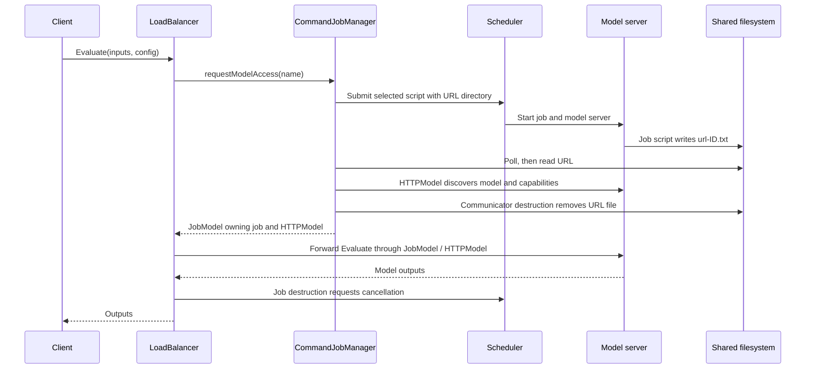

# Understanding `LoadBalancer.hpp` and `LoadBalancer.cpp`

This guide describes the implementation in [`LoadBalancer.hpp`](LoadBalancer.hpp)
and [`LoadBalancer.cpp`](LoadBalancer.cpp) in `sandbox/C++/hpc`, including its PBS
extension. A separate copy lives in [`umbridge/hpc`](../../../umbridge/hpc);
the two copies are not identical. The explanations below follow the local
sandbox code and the bundled [`umbridge.h`](../../../umbridge/lib/umbridge.h).

## Purpose and overall design

The load balancer exposes a UM-Bridge HTTP server to a client, such as a numerical
method requesting model evaluations. It obtains model servers through an HPC
scheduler and forwards operations to those servers as a UM-Bridge client. This
is the scope described in the [UM-Bridge HPC overview](https://um-bridge-benchmarks.readthedocs.io/en/docs/umbridge/hpc.html).

The implementation starts a new scheduler job each time a `LoadBalancer` method
requests model access. The job runs a server, publishes its URL, and remains
alive while the operation executes. C++ object destruction then requests job
cancellation. There is no persistent pool of model servers in these files.
With HyperQueue, several such jobs can run inside HPC allocations managed by
HyperQueue; a HyperQueue job need not correspond to a new batch allocation.

The main division of responsibilities is:

| Component | Responsibility |
| --- | --- |
| `LoadBalancer` | Expose the UM-Bridge model API and acquire a backend for each forwarded method call. |
| `JobManager` / `CommandJobManager` | Combine script selection, job submission, URL discovery, and HTTP connection creation. |
| `JobSubmitter` and its implementations | Translate environment variables into scheduler arguments and create a `Job`. |
| `Job` and its implementations | Hold a scheduler job identifier and cancel the job on destruction. |
| `JobCommunicator` / `FilesystemCommunicator` | Tell a job where to publish its server URL and read it back. |
| `JobCommunicatorFactory` / `FilesystemCommunicatorFactory` | Create a separate communicator for each submission. |
| `JobScriptLocator` | Select a default or model-specific launch script. |
| `JobModel` | Keep the scheduler job alive for as long as its HTTP model is used. |
| `main` | Assemble the components, discover model names, and start the public server. |

Most of the implementation is in the header. The `.cpp` file contains startup
helpers and `main`; the split is architectural rather than a conventional split
between declarations and definitions.

The included `umbridge.h` supplies the model interface, HTTP client/server
implementation, and `json` alias for `nlohmann::json`. Standard-library types
provide paths, containers, streams, ownership pointers, synchronization, and
timing. Some of those declarations arrive through transitive includes rather
than explicit includes in `LoadBalancer.hpp`.

## A request from start to finish

For an ordinary HTTP evaluation, the central flow is:



The scheduler runs the script; the script, rather than the C++ load balancer,
chooses a port, starts the model executable, and publishes the URL. The diagram
groups those script actions with the backend for readability.

In more detail, `CommandJobManager::requestModelAccess(name)` performs six steps:

1. `locator.selectJobScript(name)` chooses a script.
2. `job_comm_factory->create()` makes an independent communicator.
3. `comm->getInitMessage()` supplies environment variables to
   `job_submitter->submit(...)`, which returns an owning job pointer.
4. `comm->getModelUrl(job->getJobId())` waits for the URL associated with that job.
5. `umbridge::HTTPModel(url, name)` establishes the client-side model. Its
   constructor queries `/Info` to check the model name and `/ModelInfo` to read
   capabilities; constructing it already performs HTTP requests.
6. The job and HTTP model are moved into a `JobModel` returned to the caller.

The local communicator is destroyed before `requestModelAccess` returns, so its
URL file is removed **before** the forwarded evaluation begins. The URL has
already been consumed and the HTTP model retains the connection information.
The filesystem is used only to discover that URL: numerical inputs and outputs
travel over HTTP. The `HTTPModel` constructor uses its default
`useShMem = false`, so this backend connection does not enable UM-Bridge's
optional shared-memory transport.

Each overridden method of `LoadBalancer` holds the returned model in a local
`std::unique_ptr`, calls the corresponding method, and returns its result. The
return value is obtained before the local pointer is destroyed. Destruction
releases the backend model and then requests scheduler cancellation.

The correct unit of job creation is a **`LoadBalancer` method call**, rather than
necessarily one incoming HTTP request. Size and capability queries also create
jobs. The bundled HTTP `/ModelInfo` handler calls all four `Supports*` methods,
causing four separate submissions. Its `/ApplyHessian` handler additionally
calls `GetInputSizes` to check the result size, even when `error_checks` is false.

## Startup and command-line handling in `LoadBalancer.cpp`

### `clear_url(directory)`

This helper returns immediately if the directory is absent. Otherwise, it visits
its immediate entries and removes names matching `url-\d+\.txt`: for example,
`url-123.txt`. It does not recurse, and a name containing a scheduler suffix,
such as `url-123.server.txt`, does not match.

`main` calls it on `urls` before validating command-line arguments. Its purpose
is to prevent old URL files from being mistaken for newly submitted jobs. The
directory therefore must belong to this load-balancer instance; sharing it with
another active instance allows one startup to remove another instance's files.
Filesystem failures are not caught here.

### `launch_hq_with_alloc_queue()`

For HyperQueue, startup runs shell commands to stop a local HQ server, start one
in the background, repeatedly query `./hq server info` until it responds, and
execute `hq_scripts/allocation_queue.sh`.

The binary location `./hq` and the script path are relative to the process's
working directory. The commands use `&>` redirection, so they assume a shell
supporting that syntax; `std::system` does not itself guarantee Bash. Exit
statuses are ignored and the readiness loop has no timeout. There is no matching
HQ-server shutdown routine when `main` ends.

### `get_arg(args, arg_name)`

The helper searches for the first string beginning with `--<arg_name>=` and
having at least one character after `=`. It returns that suffix, or an empty
string when no matching nonempty argument exists. Thus `--port=5000` is accepted,
while `--port 5000` and `--port=` are not treated as supplied values. Unrecognized
arguments are not rejected.

| Option | Default | Use |
| --- | --- | --- |
| `--scheduler=hyperqueue`, `--scheduler=slurm`, or `--scheduler=pbs` | Required | Select the submitter and script directory. See the PBS naming issue below. |
| `--delay-ms=N` | `0` | Set the optional delay used by the submitter. |
| `--port=N` | `4242` | Select the public load-balancer TCP port. |

The two numeric options use `std::stoi`. Invalid or out-of-range conversions can
throw uncaught exceptions; the code has no explicit range checks and does not
verify that the whole string was consumed. A negative submission delay does not
enter the `delay > 0` branch.

### `main(argc, argv)`

After cleaning the URL directory, `main` reads the options and constructs the
selected scheduler components:

| Scheduler value | Submitter class intended by the design | Script directory |
| --- | --- | --- |
| `hyperqueue` | `HyperQueueSubmitter` | `hq_scripts` |
| `slurm` | `SlurmSubmitter` | `slurm_scripts` |
| `pbs` | `PBSSubmitter` | `pbs_scripts` |

Missing or unsupported scheduler values print an error and call `std::exit(-1)`.
The current PBS branch spells the class `PbsSubmitter`, whereas the header
declares `PBSSubmitter`; this is a compile-time error in the supplied source.

Startup then:

1. Creates a `FilesystemCommunicatorFactory` for `urls`, polling every 500 ms.
   Its constructor creates the directory if needed.
2. Configures `JobScriptLocator` with default `job.sh` and model-specific names
   `job_<model_name>.sh`.
3. Moves the submitter and communicator factory into a shared
   `CommandJobManager`.
4. Calls `getModelNames()`. This submits a real job using the default script,
   waits for its server, calls `umbridge::SupportedModels(url)`, and destroys
   that temporary job before continuing. The public server is not listening
   while this discovery job is pending.
5. Prints each model's selected script and creates one `LoadBalancer` object per
   discovered model name. The printed list is sorted using a copy of the names;
   the original discovery order is retained in the model vector.
6. Builds a vector of non-owning `umbridge::Model*` pointers into the completed
   `LB_vector`, then calls `umbridge::serveModels`.

The pointer conversion adapts to the UM-Bridge server API. `LB_vector` remains
alive for the blocking server call, and no later insertion invalidates its
element addresses.

The final call is:

```cpp
umbridge::serveModels(LB_ptr_vector, "0.0.0.0", port, true, false);
```

`0.0.0.0` binds on all IPv4 interfaces. `true` sets `enable_parallel`, allowing
HTTP handlers to call models without the library's serializing model lock.
`false` sets `error_checks`, disabling the checks guarded by that flag. Those
checks would otherwise call size and capability methods and therefore submit
extra jobs. It does not disable every check in the bundled library, and the
load-balancer classes themselves do not validate numerical inputs.

## Utilities and command construction in `LoadBalancer.hpp`

### `get_command_output(command)`

`popen(command.c_str(), "r")` runs a shell command and opens its standard output
for reading. A `std::unique_ptr<FILE, decltype(&pclose)>` couples the pipe to the
`pclose` cleanup function. `fgets` reads chunks into a 128-byte buffer until no
more data is available, and the chunks are concatenated into the returned
string. The buffer limits each read, not the total output size.

If `popen` cannot create the pipe, the helper throws `std::runtime_error` with
the command and `errno` description. It does not capture standard error unless
the command redirects it, and it discards the command's exit status returned by
`pclose`. It also does not inspect the stream error indicator when reading
stops. A scheduler submission failure can therefore produce empty or
unexpected output without an exception from this helper.

### Other small helpers

| Function | Exact behavior |
| --- | --- |
| `wait_for_file(file_path, polling_cycle)` | Check `std::filesystem::exists` repeatedly and sleep between failed checks. It has no timeout or scheduler-state check. |
| `read_line_from_file(file_path)` | Open the file, throw if opening fails, then return its first line. It does not verify nonempty contents or successful line extraction. |
| `remove_trailing_newline(s)` | Remove at most one final `\n`; it does not trim spaces or a preceding `\r`. |

### `Command`

This aggregate holds `exec`, a vector of `options`, and `target`.
`addOption` appends an option. `toString` joins the executable, each option, and
the target with spaces. For example, a `SlurmJob` constructs a command with
`exec = "sbatch"`, environment options, `--parsable`, and the script path.

These are shell command fragments, not an argument vector passed directly to
an executable. `Command` performs no quoting or escaping. Script paths and
environment values containing shell syntax require care, and untrusted input
must not be interpolated into this command path. The PBS environment helper
provides shell quoting for its environment list only.

## Scheduler jobs and submitters

### `Job`: resource ownership

`Job` is an abstract owner of a scheduler job, exposing `getJobId()`. Its virtual
destructor allows correct destruction through a base pointer. Copy construction,
move construction, and both assignments are deleted so two `Job` objects cannot
accidentally claim the same cancellation responsibility.

Ownership is transferred by moving a `std::unique_ptr<Job>`, which moves the
pointer rather than the `Job` itself. The concrete constructors submit jobs;
their destructors invoke scheduler cancellation commands. This is RAII
(Resource Acquisition Is Initialization): a resource's lifetime follows the
lifetime of its owning C++ object.

| Class | Submission | ID extraction | Destruction |
| --- | --- | --- | --- |
| `HyperQueueJob` | `./hq submit ... --output-mode=quiet <script>` | Keep stdout after removing one trailing newline. | `./hq job cancel <id>` |
| `SlurmJob` | `sbatch ... --parsable <script>` | Match a numeric ID, optionally followed by `;<cluster>`, and keep the digits. | `scancel <id>` |
| `PBSJob` | `qsub ... <script>` | Match a numeric ID, optionally followed by `.<server>`, and keep the digits. | `qdel <id>` |

The SLURM/PBS parsers examine output line by line, ignore nonmatching lines, and
retain the last matching ID. Their optional suffix permits only letters,
digits, `_`, and `-`; PBS array IDs or suffixes containing additional dots do not
match. No matching line leaves an empty ID. Discarding the suffix also means
subsequent cancellation and URL lookup use only the numeric component.

Each `getJobId()` simply returns the stored string. The destructors ignore
cancellation exit codes: destruction requests cancellation but does not verify
that the remote resources were released.

### `JobSubmitter`: scheduling policy and environment conversion

`JobSubmitter::submit(job_script, env)` takes a script and a map of environment
variables and returns exclusive ownership of the resulting `Job`. Its virtual
destructor supports deletion through the interface.

All three implementations store a configured delay and a mutex. For a positive
delay, `submit` locks the mutex, sleeps, and then leaves that block. **The mutex
is released before constructing the job and executing the submission command.**
It serializes the waiting sections, not entire submissions, and does not enforce
a strict minimum interval between actual scheduler command invocations.

The private `env_to_options` methods generate different command fragments:

| Submitter | Environment encoding | Additional behavior |
| --- | --- | --- |
| `HyperQueueSubmitter` | One `--env KEY=VALUE` option per map entry. | Add `--priority=-<job_count>`; increment the count after creating the job. |
| `SlurmSubmitter` | One `--export=ALL,KEY=VALUE,...` option. | Include the inherited environment via `ALL`. |
| `PBSSubmitter` | `-v` followed by a single-quoted `KEY=VALUE,...` list. | Return no options for an empty map; escape embedded single quotes for the shell. |

The HyperQueue priority becomes increasingly negative as the count increases,
expressing a preference for earlier submissions. `job_count` is atomic, so reads
and increments do not race at the C++ memory-access level. Reading its value and
later incrementing it are separate operations, however, so concurrent calls
can generate the same priority. It is not a unique job identifier.

PBS shell quoting preserves the list as one shell argument; it does not escape
the comma separators of PBS's own environment-list syntax. The generic command
builder still leaves the script path unquoted.

## Communicating a backend URL

### The interfaces

`JobCommunicator` defines two phases:

- `getInitMessage()` returns key-value pairs supplied to the job environment.
- `getModelUrl(job_id)` obtains the URL published by that job.

Its copy/move operations are deleted for the same ownership reason as `Job`:
each communicator owns its cleanup responsibility. `JobCommunicatorFactory`
exposes `create()` to obtain a fresh owning pointer for every job, avoiding
shared mutable per-job state.

### `FilesystemCommunicator`

The constructor stores `file_dir` and the polling interval. `getInitMessage()`
returns a map containing:

```text
UMBRIDGE_LOADBALANCER_COMM_FILEDIR=<file_dir>
```

`getUrlFileName(job_id)` forms `url-<job_id>.txt`. `getModelUrl` stores the full
path, logs it, waits for existence, and returns the first line. The destructor
removes that path if one has been assigned. It does not remove the directory.

`FilesystemCommunicatorFactory` stores the common directory and polling interval,
creates the directory in its constructor, and returns a new communicator from
`create()`. It calls `create_directory`, not recursive `create_directories`.

### Contract with a launch script

The C++ code assumes a script will:

1. Start a UM-Bridge server in its allocation and keep the job alive while that
   server is needed.
2. Determine a URL reachable from the load-balancer host.
3. Publish that URL as the first line of
   `$UMBRIDGE_LOADBALANCER_COMM_FILEDIR/url-<id>.txt`, using the same ID string
   returned by `Job::getJobId()`.
4. Keep the server running until the load balancer cancels the job.

The reference [SLURM script](../../../umbridge/hpc/slurm_scripts/job.sh) and
[HyperQueue script](../../../umbridge/hpc/hq_scripts/job.sh) select a free port,
export `PORT`, start `./testmodel`, wait for an HTTP response, write the URL using
`SLURM_JOB_ID` or `HQ_JOB_ID`, and finish with `sleep infinity`. Hardware resource
requests and the model launch command are configured in those scripts, not in
`LoadBalancer`.

Both processes must resolve the URL directory to the same shared filesystem
location. Since `main` supplies the relative path `urls`, the job's working
directory matters. A PBS script must normalize its job ID consistently with
`PBSJob`, which strips the server suffix. This sandbox directory currently has
no `pbs_scripts/job.sh` implementing that contract.

The C++ existence check is not a complete readiness protocol. It does not wait
for a nonempty URL, validate its format, or retry a failed HTTP connection. A
file can become visible before the writer finishes it. A script that publishes
a completed temporary file by renaming it can avoid that particular partial-file
window, but the reference scripts currently write directly to the final path.

## Script selection and model management

### `JobScriptLocator`

The public fields describe the directory, default filename, model-name prefix,
and model-name suffix. With the values from `main`, the model `heat` selects
`<script_dir>/job_heat.sh` if it exists, otherwise `<script_dir>/job.sh`.

`selectJobScript(model_name)` checks those paths in that order and throws
`std::runtime_error` if neither exists. It checks existence, not executable
permission or script validity. `getDefaultJobScript()` only constructs the
default path; it does not check existence. `printModelJobScripts(model_names)`
sorts its by-value copy and prints each selected path, potentially throwing if a
required path is absent.

The startup discovery job always uses the default script. Model-specific scripts
can give known models different resources, but cannot replace the default
discovery job. Model names are inserted directly into filenames and are assumed
to be suitable for this naming convention.

### `JobManager` and `CommandJobManager`

`JobManager` abstracts two operations: discover available names with
`getModelNames()`, and acquire a usable model with `requestModelAccess(name)`.
The returned `std::unique_ptr<umbridge::Model>` must own the resources needed for
that model and release them when destroyed.

`CommandJobManager` owns one submitter, one communicator factory, and a locator
value. Its constructor accepts the first two through `unique_ptr` and moves
them into members. The acquisition procedure was described above.

`getModelNames()` uses the same submission/communication mechanisms, but invokes
`umbridge::SupportedModels(url)` directly rather than constructing a `JobModel`.
The function returns the discovered names; its local job is destroyed first,
then its communicator removes the URL file. It
does not cache a backend or retain that first server for later requests.

Neither operation receives model inputs or `config_json`. Job scripts are
selected by model name alone, so numerical configuration cannot dynamically
change resource requests through this interface.

### `JobModel`: couple a model to its job

`JobModel` derives from `umbridge::Model` and stores both a `unique_ptr<Job>` and
a `unique_ptr<umbridge::Model>`. Its constructor copies the wrapped model's name
into the base class, then takes ownership of both pointers. Both are expected to
refer to valid objects; the constructor dereferences the model pointer.

All numerical, size, and capability methods delegate to the stored model
without changing arguments or results. This repetition preserves the full
virtual interface while adding lifetime management around it.

No explicit destructor is necessary: members are destroyed in reverse
declaration order. `model` is declared after `job`, so the HTTP model is destroyed
first and the scheduler job second. A virtual destructor inherited from
`umbridge::Model` makes this work when the wrapper is held as a base pointer.

## The numerical interface exposed by `LoadBalancer`

The constructor stores a model name in the `umbridge::Model` base and shares the
`JobManager` via `std::shared_ptr`. All named load balancers therefore use the
same submission infrastructure. The constructor itself does not submit a job.

The numerical data use blocks: `std::vector<std::vector<double>>` represents a
list of input or output vectors, not necessarily a rectangular matrix. For
example, input sizes `{3, 1}` describe two input blocks with lengths three and
one. Indices such as `inWrt` and `outWrt` select blocks, starting at zero.

Let output block `F_i(x)` have length `m_i`, and input block `x_j` length `n_j`.
Write its Jacobian block as `J_ij = dF_i/dx_j`.

| Method | Meaning and returned data |
| --- | --- |
| `GetInputSizes(config_json)` | Length of every input block under the supplied model configuration. |
| `GetOutputSizes(config_json)` | Length of every output block under that configuration. |
| `Evaluate(inputs, config_json)` | Evaluate all output blocks at the input blocks. |
| `Gradient(outWrt, inWrt, inputs, sens, config_json)` | Return `J_ij^T sens`, an `n_j`-element vector. `sens` has `m_i` entries. |
| `ApplyJacobian(outWrt, inWrt, inputs, vec, config_json)` | Return `J_ij vec`, an `m_i`-element vector. `vec` has `n_j` entries. |
| `ApplyHessian(outWrt, inWrt1, inWrt2, inputs, sens, vec, config_json)` | Apply the mixed Hessian of the scalar `sens^T F_i(x)` to `vec` in input block `inWrt2`; return a vector in block `inWrt1`. |
| `SupportsEvaluate()` | Report whether evaluation is supported. |
| `SupportsGradient()` | Report whether the gradient operation is supported. |
| `SupportsApplyJacobian()` | Report whether a Jacobian action is supported. |
| `SupportsApplyHessian()` | Report whether a Hessian action is supported. |

For the Hessian action, the relevant matrix has dimensions
`n_inWrt1 × n_inWrt2`. `sens` selects a weighted combination of entries in output
block `outWrt`; `vec` supplies a direction in input block `inWrt2`.

`config_json` is the model-specific JSON configuration, defaulting to an empty
object at these declarations. The load balancer forwards it unchanged. It does
not compute derivatives, approximate unsupported operations, or interpret model
parameters. Those responsibilities belong to the backend.

`JobModel` forwards each method to an already acquired model. `LoadBalancer`
first acquires a new one, then forwards the same method. This distinction is
why every size or support method in `LoadBalancer` has scheduling cost. Although
`HTTPModel` caches capability flags in its constructor, the load balancer
constructs a new HTTP model for each of its capability queries.

## Concurrency, ownership, and failures

The public server can process concurrent requests because `enable_parallel` is
true. Each acquisition has its own communicator, scheduler job, and HTTP model;
expensive model evaluations can therefore occupy different scheduled resources.
The HPC scheduler decides when those resources become available. The C++ code
does not implement its own job queue, admission limit, load metric, or worker
reuse policy.

Shared state is limited mainly to the manager's components: a submitter's mutex
and, for HyperQueue, atomic counter. Each communicator has its own `file_path`.
Correct filesystem isolation still depends on IDs and paths being unique and
consistent. The delay mutex is not held while an evaluation runs.

Normal return and ordinary exception unwinding destroy owning pointers. If URL
reading or HTTP-model construction throws after a job was acquired, its local
`unique_ptr` requests cancellation on the way out. Once ownership has moved
into `JobModel`, destruction of that wrapper performs the same cleanup.

There are limits to that guarantee:

- A failed submission can leave an empty or malformed ID because command exit
  codes and parsed IDs are not validated.
- Waiting for a URL has no timeout, cancellation signal, or job-failure check;
  a job that never publishes a URL can leave the request waiting indefinitely.
- A forced process termination does not run C++ destructors, and this code
  installs no signal-driven cleanup handler.
- Scheduler cancellation failures are ignored. The filesystem destructor uses
  the throwing form of `std::filesystem::remove`; an exception escaping a
  destructor can terminate the process.
- The code does not catch and translate its startup failures in `main`. Stack
  unwinding is not guaranteed when an exception escapes `main`, so cleanup
  cannot be assumed in that case. Runtime HTTP failure handling also depends on
  the bundled UM-Bridge/HTTP library.

These are descriptions of the present implementation, rather than behavior
added by the documentation changes.

## Building and extending this local copy

The code requires C++17 features, including `std::filesystem`, structured
bindings, and class-template argument deduction. It relies on the bundled
UM-Bridge header and its `json.hpp`/`httplib.h` dependencies, threads, POSIX
process facilities, scheduler commands, and a shared URL directory.

The sandbox copy is not currently a complete standalone deployment:

- `LoadBalancer.cpp` refers to `PbsSubmitter`, but the declared class is
  `PBSSubmitter`. C++ identifiers are case-sensitive, so this must be reconciled
  before the translation unit can compile.
- The header includes `"umbridge.h"`, while the `.cpp` also includes
  `"../lib/umbridge.h"`. There is no `sandbox/C++/lib` directory. Suitable include
  search paths can resolve both to the bundled header: `-Iumbridge/lib` from the
  workspace root resolves the includes in the current layout. The relative
  include is not satisfied by the sandbox layout alone.
- [`sandbox/C++/Makefile`](../Makefile) builds `minimal-server` and `http-client`,
  not the load balancer. The separate [upstream HPC Makefile](../../../umbridge/hpc/Makefile)
  provides a build recipe for its own directory layout.
- `hq_scripts`, `slurm_scripts`, and `pbs_scripts` are absent from this sandbox
  `hpc` directory. The first two have reference implementations in
  [`umbridge/hpc`](../../../umbridge/hpc); a compatible PBS model-job script is
  still needed for a PBS deployment.
- [`LoadBalancer.pbs`](LoadBalancer.pbs) is a batch launcher for the load-balancer
  executable, not the per-model URL-publishing script. Its current invocation
  also omits the required `--scheduler=...` option.

Once a working build and launch-script layout are supplied, the intended command
syntax is, for example:

```sh
./load-balancer --scheduler=slurm --port=4242 --delay-ms=100
```

All relative paths are resolved against the launch directory,
not automatically against the source-file directory.

The interfaces expose several clear extension points:

| Desired change | Main code to extend |
| --- | --- |
| Add another scheduler | Implement `Job` and `JobSubmitter`, then add a branch in `main`. |
| Publish URLs without a shared filesystem | Implement `JobCommunicator` and its factory, and adapt launch scripts to the new protocol. |
| Give a known model different HPC resources | Supply `job_<model_name>.sh` in the selected script directory. |
| Reuse backend servers | Implement a manager with an explicit leasing/pooling lifetime policy; preserve release-on-destruction behavior. |
| Bound startup time or detect failed jobs | Extend job-state inspection and URL waiting with explicit failure/timeout handling. |
| Schedule based on configuration | Extend the manager/submitter interface to receive the necessary configuration. |

As written, the header has no include guard and contains non-`inline` free
function definitions. Its present single-translation-unit use avoids some of
the resulting problems; reuse from multiple translation units would require
addressing duplicate inclusion/definition issues.

## Reading the Doxygen reference

The Doxygen comments alongside the declarations provide the API-level reference:
parameters, return values, ownership expectations, and important failure
conditions. This guide supplies the cross-class control flow and the operational
context needed to understand those declarations together.

For an HTML reference, run Doxygen from `sandbox/C++/hpc` with a configuration
containing the following settings. `EXTRACT_PRIVATE` includes the environment
conversion and URL-filename helpers.

```text
PROJECT_NAME           = "UM-Bridge LoadBalancer"
OUTPUT_DIRECTORY       = /tmp/loadbalancer-doxygen
INPUT                  = LoadBalancer.hpp LoadBalancer.cpp LoadBalancer.md
USE_MDFILE_AS_MAINPAGE  = LoadBalancer.md
EXTRACT_ALL            = YES
EXTRACT_PRIVATE        = YES
GENERATE_HTML          = YES
GENERATE_LATEX         = NO
```

Save that configuration as a temporary Doxyfile, run `doxygen <Doxyfile-path>`,
and open `/tmp/loadbalancer-doxygen/html/index.html`. Generating documentation
parses the sources; it does not require a successful executable build or submit
HPC jobs.
