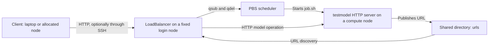
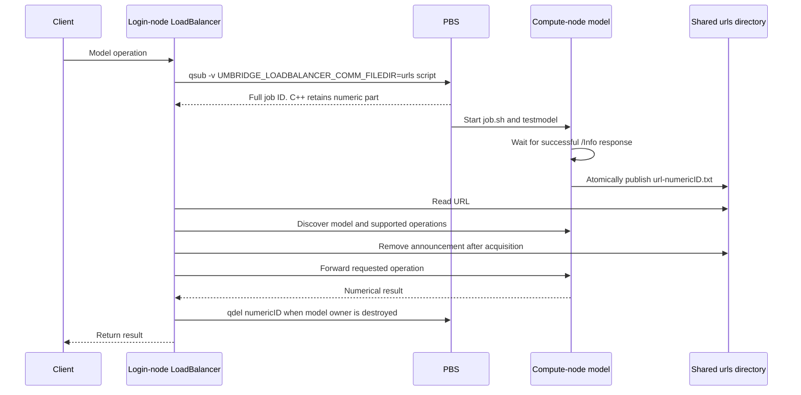

# Running UM-Bridge on a PBS cluster with the load balancer on a login node

This guide describes the implementation in this checkout of
[`LoadBalancer.cpp`](LoadBalancer.cpp) and [`LoadBalancer.hpp`](LoadBalancer.hpp),
and the accompanying PBS model-server script, [`job.sh`](job.sh). It is intended
to be followed from preparation through a first evaluation, then used as an
operations and troubleshooting reference. The implementation and documentation
were reviewed on 31 October 2026.

The deployment has three roles: a client submits numerical requests; a
`LoadBalancer` process on one login node accepts those requests; and PBS starts
the actual model servers on compute nodes. This arrangement follows the general
[UM-Bridge HPC architecture](https://um-bridge-benchmarks.readthedocs.io/en/docs/umbridge/hpc.html).
The direct `--scheduler=pbs` implementation described here is a local extension;
the upstream instructions primarily describe direct SLURM submission and
HyperQueue, which can itself request PBS allocations.

The examples use **`testmodel` as both the executable filename and the model
name advertised through the UM-Bridge API**. They are separate names. The build
instructions deliberately make a demo that uses both. Replace them with your
own executable and advertised model name when deploying a real application.

The guide assumes PBS Professional/OpenPBS-style resource directives, a shared
filesystem, and permission to run a lightweight HTTP service on the login node.
Queue names, account names, resource requests, module setup, network names, and
login-session management must be adapted to the cluster. No real PBS submission
is required merely to build the software or read `--help`.

To rehearse everything on a multicore PC without PBS, see
[Section 13](#13-rehearsal-on-your-own-pc-with-the-fake-pbs-commands).

## 1. Deployment overview and terminology



There are two HTTP connections to arrange. The client must reach the login-node
listener, normally on port `4242`. Independently, the login node must reach the
compute-node model server on the port selected by `job.sh`. An SSH tunnel for
the first connection does not establish the second connection. The shared
filesystem carries a small URL announcement; numerical inputs and outputs
travel through HTTP.

| Name in this guide | Meaning | Where it is used |
| --- | --- | --- |
| `LoadBalancer` | The login-node executable, with this exact capitalization | Built by the local HPC Makefile |
| `testmodel` executable | A program that serves the UM-Bridge HTTP protocol | `model_command=(./testmodel)` in `job.sh` |
| `testmodel` API name | The name of a numerical model inside that server | Client model selection and JSON `name` fields |
| `testmodel` PBS job name | A readable scheduler label | `#PBS -N testmodel`; it does not set either name above |
| Public port | Stable port on the login node | `LoadBalancer --port=4242` |
| Backend port | A separate port chosen inside each allocation | Exported as `PORT` before starting `testmodel` |
| Full PBS job ID | Scheduler identifier, for example `12345.pbs01` | PBS diagnostics and manual cancellation |
| Numeric job ID | `12345` in the preceding example | This implementation's URL filename and automatic `qdel` command |

A UM-Bridge server may advertise several models. A model exposes input/output
dimensions, evaluation, and optional derivative operations. The general
programming interface is described in the
[official model documentation](https://um-bridge-benchmarks.readthedocs.io/en/docs/umbridge/models.html).
The deployment-specific behavior below comes from the local C++ sources.

### Existing sample names require attention

This directory contains a ready-made demo model, [`testmodel.cpp`](testmodel.cpp),
which registers the API name `"testmodel"`, and a prototype client,
[`http-client.cpp`](http-client.cpp), which requests `"testmodel"`. The older
sandbox pair one level up ([`../minimal-server.cpp`](../minimal-server.cpp) and
[`../http-client.cpp`](../http-client.cpp)) registers and selects `"forward"`
instead; do not mix the two pairs. Renaming an executable file does not change
the API name compiled into it. The Python and `curl` examples in this guide use
`testmodel`.

All four programs of this directory (`LoadBalancer`, `is_port_free`,
`testmodel`, `http-client`) are built by the supplied `Makefile`; see Section 4.

The demo model accepts one vector with two entries and computes
`2*x[0] + 3*x[1]`. Thus `[[100.0, 18.0]]` produces `[[254.0]]`. The official
downloadable/container test model has a different example contract; do not
substitute its input dimensions for those of the sandbox demo.

## 2. What the local load balancer actually does

### 2.1 Initial discovery happens before the login-node listener starts

For `--scheduler=pbs`, `main()` performs the following steps:

1. Validate command-line options.
2. Remove existing regular files named `urls/url-<digits>.txt` in its working
   directory.
3. Construct a `PBSSubmitter`, a filesystem communicator factory, and a script
   locator using the relative directory `pbs_scripts`.
4. Submit **one real PBS job** using the default `pbs_scripts/job.sh`.
5. Poll for that job's URL announcement, query the backend `/Info`, and collect
   the model names it advertises.
6. Request cancellation of the discovery job and remove its URL announcement.
7. Create a proxy for each discovered model and start the public HTTP listener.

Consequently, the public port can remain unavailable while the discovery job is
queued. The messages about a URL file and the job's state in `qstat` are more
useful at that stage than repeatedly trying the public endpoint. Model names
are discovered once at startup; restart the balancer after changing the set of
advertised models.

### 2.2 A model operation acquires a fresh PBS job



`CommandJobManager::requestModelAccess()` creates a communicator, submits a
script, reads its URL, and constructs an `umbridge::HTTPModel`. A `JobModel`
keeps the scheduler job alive while the requested operation runs. Destruction
of that owner invokes `qdel` through `PBSJob`. Normal exception unwinding also
releases already-owned jobs.

This applies to evaluation, derivatives, size queries, and support queries.
There is no retained backend pool, result cache, or metadata cache in
`LoadBalancer`. A backend HTTP client's discovery calls happen within the job
already being acquired; they do not recursively submit more PBS jobs.

The public server allows concurrent requests. Each acquisition has its own job
and communicator, while PBS decides when resources become available. The
load balancer does not impose a maximum number of queued or running jobs.

### 2.3 Metadata has a scheduling cost

With the bundled [`umbridge.h`](../../../umbridge/lib/umbridge.h), the following
costs follow from its HTTP handlers and the local proxy methods:

| Request to the login-node balancer | New PBS jobs after startup |
| --- | ---: |
| `GET /Info` | 0 |
| `POST /ModelInfo` | 4: one for each support query |
| `POST /InputSizes` | 1 |
| `POST /OutputSizes` | 1 |
| One evaluation | 1 |
| One supported Jacobian action | 1 |

Use `/Info` for a lightweight service-liveness check. Creating a high-level
client object may request `/ModelInfo`; it is not necessarily a cheap local
operation. For example, the prototype C++ client's normal path without
Jacobian support creates ten jobs after startup: four support checks, four size
queries across its two configurations, and two evaluations. The startup
discovery adds another job. These counts describe this checkout, not a promise
about every UM-Bridge version or client implementation.

## 3. Prerequisites and compatibility checks

### 3.1 Shared storage and software

Choose a project directory visible under the same path from the login and
compute nodes. The model executable, its libraries/data, the helper executable,
the job script, and `urls` must be accessible there. The script explicitly
returns to the submission directory before using relative paths.

The login node needs a C++20-capable compiler (the Makefile uses `-std=c++20`) for building, GNU Make, real PBS client
commands, and the bundled UM-Bridge headers. The supplied Makefiles link
OpenSSL; install/load the cluster's OpenSSL development environment as needed.
Compute nodes need Bash, `curl`, `shuf`, `hostname`, `mktemp`, standard file
utilities, and the runtime libraries required by the compiled model and helper.
Load compiler, MPI, Python, or container modules in the job script if the model
depends on them. A module loaded in an interactive login shell does not by itself
document or reproduce the compute job's environment.

### 3.2 Make sure the commands are real PBS commands

On the login node, inspect:

```bash
type -a qsub qstat qdel
command -v qsub
command -v qdel
```

The subfolder `hpc/bin` contains fake `qsub`, `qstat` and `qdel` scripts for
rehearsing on a PC without PBS (Section 13). They are kept apart from the
deployment directory precisely so that they cannot shadow the real commands:
**on the cluster, never put `hpc/bin` in `PATH`.** The C++ code invokes the
bare command names through a shell; shell aliases and interactive functions are
not a reliable way to choose the scheduler binary. Use the site's PBS
environment/module and verify the resolved executable paths.

The fake commands support `-v`, `PBS_JOBID`, `PBS_O_WORKDIR` and `qdel`
termination of the whole job, so they permit an end-to-end test of the software
logic, but they say nothing about the cluster's queues, network or modules.
Their `MAX_JOBS` setting has no effect on a real PBS scheduler.

### 3.3 Check the full PBS job ID format before using the balancer

The current `PBSJob` parser accepts only:

```text
12345
12345.pbs01
12345.pbs-server_1
```

The suffix may contain letters, digits, underscores, and hyphens. It cannot
contain a further dot. Forms such as `12345.pbs.cluster.example`, array IDs, and
`12345.pbs01@other-server` are not accepted by this C++ implementation. The
converted job script deliberately enforces the same restriction.

Verify the format using a small manual job as described in section 6. If the
cluster emits an unsupported format, resolve the compatibility issue before
starting the balancer. A C++ parser/identifier-handling change would be required
for general support; editing only the filename in `job.sh` is insufficient.
Successful scheduler submission followed by a parser error can leave a submitted
job without a C++ owner. Inspect `qstat` and cancel such a job manually using its
full PBS ID.

Automatic cancellation uses only the numeric portion, for example `qdel 12345`.
The PBS client environment must therefore select the correct default server.
The scheduler itself supports broader identifiers than this local adapter;
see the [OpenPBS deletion command](https://github.com/openpbs/openpbs/blob/master/doc/man1/qdel.1B).

### 3.4 Verify the network paths

Confirm that the login node can resolve the compute-node hostname advertised by
the script and connect to the chosen backend TCP port. The default script uses
`hostname -f` and randomly selects a port from `1024` through `65535`. If the
cluster permits only a restricted port range, change `port_min` and `port_max`
in the script to that range. If compute nodes have several interfaces, set
`advertise_host` to the name/address reachable from the login node.

The model must bind to a reachable interface, normally `0.0.0.0`, rather than
only its own loopback interface. Never publish `localhost` or `127.0.0.1` as the
compute-node address: the login-node client would interpret that as the login
node itself. A readiness request made on the compute node is useful but does
not prove that login-to-compute routing or firewall rules are correct.

The current public listener uses plain HTTP on `0.0.0.0:<port>`. It has no
command-line authentication, TLS, or bind-address setting. Restrict access using
the site's network controls and supported service-hosting arrangement. A
reachable caller can trigger work submitted under the balancer's PBS identity.
An SSH tunnel protects and exposes the client-to-login connection; it does not
change the listener's bind address or add application authentication.

## 4. Prepare the directory and build the executables

Use a shared checkout path in the following commands. Replace the example value
of `UMBRIDGE_PROJECT` with the actual root containing `sandbox` and `umbridge`.
The path should avoid whitespace and shell metacharacters; this adapter checks
raw script arguments before passing them to a shell.

```bash
export UMBRIDGE_PROJECT=/shared/project/SparseGrid
cd "$UMBRIDGE_PROJECT/sandbox/C++/hpc"

make
```

The supplied [`Makefile`](Makefile) builds all four programs: **`LoadBalancer`**
(not `load-balancer`), the helper `is_port_free`, the demo model `testmodel`,
and the client `http-client`. It compiles with C++20 and links OpenSSL
(`-lssl -lcrypto`), so the OpenSSL development package must be installed.
`make` rebuilds only what is out of date; to build a single program, name it,
for example `make testmodel`. `make clean` removes `LoadBalancer` and
`is_port_free`. The helper probes an IPv4 bind; it does not reserve the port
after the helper process exits.

The demonstration model is supplied in this directory as
[`testmodel.cpp`](testmodel.cpp): it registers the API name `"testmodel"`, reads
the listening port from the `PORT` environment variable (default 4242) and an
optional artificial delay in milliseconds from `TEST_DELAY`, and computes
`2*x[0] + 3*x[1]`. It is compiled by the `make` command above. If you adapt it,
keep the name passed to `umbridge::Model(...)` identical to the name your client
requests, and run `make testmodel` again after every change. Then prepare the
remaining directories and check that everything is in place:

```bash
mkdir -p urls
test -r pbs_scripts/job.sh
test -x ./testmodel
test -x ./is_port_free
./LoadBalancer --help
```

The resulting layout is:

```text
sandbox/C++/hpc/                 <- submission directory and balancer working directory
├── LoadBalancer                 <- login-node executable
├── LoadBalancer.cpp
├── LoadBalancer.hpp
├── bin/                         <- fake PBS commands, PC rehearsal only (Section 13)
│   ├── qsub
│   ├── qstat
│   ├── qdel
│   └── fakepbs-common.sh        <- helper sourced by the three commands
├── pbs_scripts/
│   └── job.sh                   <- default script used by LoadBalancer
├── is_port_free                 <- compute-node helper
├── testmodel                    <- compute-node model executable
├── testmodel.cpp                <- demo model source (supplied)
├── http-client.cpp              <- prototype C++ client (supplied), see Section 8.4
├── http-client                  <- client executable, built in Section 8.4
└── urls/                        <- transient URL announcements
```

Do not launch two balancers in the same working directory. Startup removes URL
files matching the naming convention, and one instance can delete another
instance's announcements. A different public port alone does not isolate the
shared state. Give each independent deployment its own working directory,
`urls`, and script setup.

## 5. Configure and understand the PBS model job

### 5.1 Resource requests and customization points

The converted [`job.sh`](pbs_scripts/job.sh) begins with:

```bash
#!/bin/bash
#PBS -S /bin/bash
#PBS -N testmodel
#PBS -l select=1:ncpus=1:mpiprocs=1:mem=1gb
#PBS -l walltime=00:05:00
##PBS -q CHANGE_ME_QUEUE
##PBS -A CHANGE_ME_PROJECT
```

Change `##PBS` to `#PBS` only after replacing the queue/account placeholder with
a valid site value. The one-CPU, one-GiB, five-minute allocation is a starting
point for the tiny demo. Allocate enough time for environment setup, server
startup, the requested operation, and normal teardown. Resource syntax and site
limits must match the installed scheduler; the chunk-resource definitions are
documented in the
[OpenPBS resource manual](https://github.com/openpbs/openpbs/blob/master/doc/man1/pbs_resources.7B).

| Setting in `job.sh` | Default | What to change for your model |
| --- | --- | --- |
| `model_command` | `(./testmodel)` | Executable and arguments; use array entries to preserve argument boundaries |
| PBS `select` | One chunk, one CPU, one MPI process, 1 GiB | CPU, memory, GPU, and node requirements supported by your site |
| PBS `walltime` | `00:05:00` | Longest expected startup plus one operation, with margin |
| Queue/account directives | Commented placeholders | Site-required queue and project/account |
| Module initialization | Commented edit point | Compiler, libraries, MPI, Python environment, or container setup |
| `startup_timeout_seconds` | `120` | Time allowed for backend readiness after the job starts running |
| `port_min`, `port_max` | `1024`, `65535` | A login-reachable, site-permitted TCP port range |
| `port_attempts` | `100` | Maximum candidate ports to probe |
| `advertise_host` | Output of `hostname -f` | Compute-node name reachable from the login node |

LoadBalancer sends the equivalent of:

```bash
qsub -v 'UMBRIDGE_LOADBALANCER_COMM_FILEDIR=urls' pbs_scripts/job.sh
```

The selected-variable export is intentional. The implementation does not add
`-V` or automatically forward arbitrary settings from the login shell. Put
application settings in the script, or explicitly arrange their export using
the site's PBS mechanisms. PBS provides `PBS_JOBID` and `PBS_O_WORKDIR`; `-v`
supplies the URL-directory variable. See the
[OpenPBS submission manual](https://github.com/openpbs/openpbs/blob/master/doc/man1/qsub.1B).

For example, setting `export TEST_DELAY=2000` only in your login shell is not a
reliable way to configure this batch job. Add the desired assignment in the
job's environment-setup section if you are using the sandbox demo's delay
facility. Do not assume `PORT` from the login shell controls the backend: the
script deliberately assigns it after selecting a port.

### 5.2 What the converted script does

The script validates its required environment and runs `cd "$PBS_O_WORKDIR"`.
It checks the full ID against the adapter's supported format, extracts the
numeric component, and prepares the communication directory. This keeps
`./testmodel`, `./is_port_free`, and relative `urls` anchored at the same shared
directory that the login-node balancer uses.

Next it selects a port, exports `PORT`, launches the model command in the
background, and records the process ID. It requests the model's `/Info` endpoint
with `curl`, bypassing web proxies and requiring a successful HTTP status. The
check has bounded individual connection/request times and checks whether the
model process is still alive. Full UM-Bridge body/protocol validation follows
when the load balancer connects.

Once the server responds, the script writes a complete URL to a temporary file
in the communication directory and renames it to the final filename. For
`PBS_JOBID=12345.pbs01`, the final contents look like:

```text
# filename: urls/url-12345.txt
http://compute017.cluster.internal:53017
```

The actual file contains only the URL line, without the explanatory comment.
The rename avoids exposing a newly created but empty announcement to the
balancer, which treats an empty line as an error. Publication and final rename
take place in the same shared directory.

Finally, the batch script waits for the model process. If the model exits, the
script ends; it does not remain in `sleep infinity`. On termination, its trap
attempts to stop and reap the directly launched model process and remove an
unfinished temporary announcement. PBS manages the complete allocation and its
process tree. The script leaves removal of the final URL announcement to the
balancer's communicator.

### 5.3 Timeouts, liveness, and file lifetime

The script's 120-second startup timer begins **after PBS starts executing the
job**, not while it waits in the queue. A bounded `curl` attempt can make the
observed cutoff slightly longer. PBS walltime governs the running allocation.

The C++ balancer polls for the URL file every 500 ms with **no overall timeout**
and no `qstat` query. If the script fails before publication, its new timeout or
liveness check stops that job, but the balancer can still wait forever for the
missing file. Diagnose and resolve such failures using the job state and logs;
do not interpret the script timeout as a timeout for the whole client request.

The URL file is a startup handshake. During normal acquisition, the balancer
removes it after constructing the HTTP model, even though the job may still be
running the numerical operation. Absence of a URL file therefore does not prove
that its job has finished. Use scheduler state and logs to determine job status.

### 5.4 PBS standard output and standard error

The template leaves PBS's per-job output and error destinations in place. With
the default job name, these are typically `testmodel.o<sequence>` and
`testmodel.e<sequence>` in the submission directory, subject to site settings.
Their delivery or visibility during execution depends on the site's spooling
configuration. `qstat -f <full-job-id>` shows the configured output/error paths.
The submission manual linked above describes `-o` and `-e` overrides.

Do not write `#PBS -o output_${PBS_JOBID}` expecting ordinary shell variable
expansion: PBS processes directives before the job shell executes. Avoid a
single fixed log filename shared by all jobs, because concurrent requests would
overwrite or mix their logs. The fake PBS of Section 13 follows the real default
naming (`<name>.o<id>`, `<name>.e<id>`) and honors `-o`/`-e`, but it does not
reproduce site spooling behavior.

## 6. Test one backend job manually before starting LoadBalancer

This test isolates scheduling, the batch environment, the model executable,
shared storage, and login-to-compute networking. Run it from the deployment
directory on the login node, using the real PBS commands:

```bash
cd "$UMBRIDGE_PROJECT/sandbox/C++/hpc"
mkdir -p urls

pbs_job_id=$(qsub -v 'UMBRIDGE_LOADBALANCER_COMM_FILEDIR=urls' pbs_scripts/job.sh)
printf 'Submitted PBS job: %s\n' "$pbs_job_id"
qstat -f "$pbs_job_id"
```

Check the returned ID before continuing. Keep the complete string for
diagnostics and manual cancellation. For a supported ID such as
`12345.pbs01`, derive the handshake path as follows:

```bash
numeric_job_id=${pbs_job_id%%.*}
url_file="urls/url-${numeric_job_id}.txt"
printf 'Expected URL file: %s\n' "$url_file"
```

While the job is queued, no URL file is expected. Inspect `qstat` and the PBS
logs rather than assuming an application failure. Once the job is running and
the announcement exists:

```bash
model_url=$(head -n 1 "$url_file")
printf 'Backend address: %s\n' "$model_url"

curl --fail --show-error --noproxy '*' \
    --connect-timeout 5 --max-time 15 "$model_url/Info"

curl --fail --show-error --noproxy '*' \
    --connect-timeout 5 --max-time 30 \
    -H 'Content-Type: application/json' \
    -d '{"name":"testmodel","input":[[100.0,18.0]],"config":{}}' \
    "$model_url/Evaluate"
```

For the renamed sandbox demo, `/Info` advertises `testmodel`, and the evaluation
contains `"output":[[254.0]]` (numeric formatting may differ). If `/Info`
advertises `forward`, the executable was built without changing its registered
model name. Adapt the client name or rebuild the intended demo.

These requests go directly to the one compute-node server. They do not use the
balancer or start additional jobs. After the test, cancel only that job and
remove its manual-test announcement:

```bash
qdel "$pbs_job_id"
rm -f -- "$url_file"
```

If submission succeeded but the returned ID format is unsupported, use its full
ID to cancel it and fix the compatibility issue before proceeding. If the
backend test fails, resolve it here: the balancer cannot repair an incorrect
module environment, an unreachable compute hostname, or a model that ignores
the selected `PORT`.

## 7. Start the load balancer on the login node

Record the specific login host, then start the process from the shared
deployment directory:

```bash
cd "$UMBRIDGE_PROJECT/sandbox/C++/hpc"
hostname -f
./LoadBalancer --scheduler=pbs --port=4242 --delay-ms=0
```

Keep this foreground launch for the first test so startup messages are visible.
The expected sequence includes waiting for the discovery job's URL file, then
printing available model names and selected job scripts. Initial availability
depends on PBS queue time. In a second session on the **same login node**, check:

```bash
curl --fail --show-error --noproxy '*' \
    --connect-timeout 5 --max-time 15 http://127.0.0.1:4242/Info
```

After successful startup, this should report the `testmodel` name without
submitting another job. Verify endpoint reachability explicitly: the bundled
server does not give this `main()` a reliable bind-success result to report.
If another process already owns port 4242, choose a different port and update
the clients and tunnel accordingly.

| Option | Required/default | Effect |
| --- | --- | --- |
| `--scheduler=pbs` | Required scheduler selection | Use the local PBS submitter and `pbs_scripts` |
| `--port=<integer>` | Default `4242`, range `1..65535` | Public login-node listener; unprivileged users normally choose a port above 1023 |
| `--delay-ms=<integer>` | Default `0`, range `0..2147483647` on the usual 32-bit `int` platforms | Sleep before each submission |
| `--help` | Optional | Print syntax/defaults and exit without cleanup or scheduling |

Use `--name=value`; the separated `--name value` form is not accepted. Unknown,
duplicate, empty, and out-of-range options are rejected before startup work.

A positive delay serializes the submitter's sleep intervals but releases its
mutex before invoking `qsub`. It is not a strict rate limiter or a maximum-job
setting. Use PBS policies and bounded client concurrency to control the amount
of work submitted.

For longer sessions, use the site's approved persistent-session/service method.
For example, where allowed, start the same foreground command inside `tmux` and
redirect output to a chosen log file. Keep a record of the exact login host,
working directory, public port, and process/session identity. Logging into a
generic cluster address later may place you on a different login node.

Do not submit the existing [`LoadBalancer.pbs`](LoadBalancer.pbs) for this
architecture. It is an older batch wrapper with a different execution location,
a lowercase executable name, and no mandatory scheduler option. Here the login
node runs `LoadBalancer`; PBS runs `pbs_scripts/job.sh` for each backend job.

## 8. Connect a client and perform an evaluation

### 8.1 Start with one direct protocol request

From the same login node, the following request goes through the balancer and
therefore submits a model job:

```bash
curl --fail --show-error --noproxy '*' \
    -H 'Content-Type: application/json' \
    -d '{"name":"testmodel","input":[[100.0,18.0]],"config":{}}' \
    http://127.0.0.1:4242/Evaluate
```

Expect `[[254.0]]` for the demo. Unlike the earlier manual backend request, the
elapsed time includes PBS queue delay, model-server startup, and proxy setup.
No short `--max-time` is imposed in this example because a queued job may take
longer; apply a client timeout appropriate to the workflow, understanding that
client disconnection is not implemented as a PBS cancellation mechanism here.
The protocol endpoint roles are described in the
[UM-Bridge interface reference](https://um-bridge-benchmarks.readthedocs.io/en/docs/umbridge/lib.html).

### 8.2 Python client using the advertised `testmodel` name

Install the Python integration in an appropriate user environment on the client
machine. On a laptop, for example:

```bash
python3 -m venv .venv-umbridge
. .venv-umbridge/bin/activate
python -m pip install umbridge
```

Then use:

```python
import umbridge

url = "http://127.0.0.1:4242"
model_name = "testmodel"  # CHANGE ME to the name advertised by /Info.

print("Available models:", umbridge.supported_models(url))
model = umbridge.HTTPModel(url, model_name)
print("Input sizes:", model.get_input_sizes())
print("Output sizes:", model.get_output_sizes())
print("Result:", model([[100.0, 18.0]], {}))
```

The list-of-lists input represents a list of vector blocks, not an instruction
to batch several evaluations. Set the vectors and configuration according to
your model's own contract. Model-specific configuration is a JSON-compatible
mapping; it is not a PBS resource request. The integration APIs are documented
in the [official client guide](https://um-bridge-benchmarks.readthedocs.io/en/docs/umbridge/clients.html).

The example's capability discovery and dimension queries can submit extra PBS
jobs. Avoid rebuilding the client object and requesting unchanged metadata in
every iteration of a UQ loop when the client library permits reuse. Actual
model calls still acquire fresh backend jobs in this balancer.

### 8.3 Use a laptop through an SSH tunnel

Connect to the exact login node hosting the process, or use a site-supported
gateway route to that node. When SSH terminates on the same login node, run on
the laptop:

```bash
ssh -N -o ExitOnForwardFailure=yes \
    -L 127.0.0.1:4242:127.0.0.1:4242 \
    USER@login01.cluster.example
```

Keep this SSH session open, then run the client on the laptop with
`http://127.0.0.1:4242`. The first address/port is the laptop's local listener;
the second is interpreted from the SSH server's side. If laptop port 4242 is
already occupied, choose a different local port and use it in the laptop client.
If a gateway differs from the load-balancer host, the forwarding destination
must be the actual login host reachable from that gateway. UM-Bridge's
[HPC documentation](https://um-bridge-benchmarks.readthedocs.io/en/docs/umbridge/hpc.html#optional-running-clients-on-your-own-machine-while-offloading-runs-to-hpc)
also describes this client arrangement.

The tunnel carries requests to the login-node balancer. No compute-node URL
needs to be exposed directly to the laptop, and the laptop does not need access
to the shared `urls` directory.

### 8.4 Use the prototype C++ client

[`http-client.cpp`](http-client.cpp) in this directory is a small, complete
example of a C++ UM-Bridge client. Treat it as a template: copy it and adapt it
to your own model. It is written for `testmodel` and needs no source edits to
run the demo. It does the following:

1. connects to the server address given as its only argument;
2. lists the available models (`Supported models:`);
3. selects the model named in the variable `model_name` (here `"testmodel"`)
   and stops with an error if the server does not offer it or if it does not
   support evaluation;
4. checks the input/output dimensions reported by the server;
5. evaluates the model with fixed inputs, then a second time with the
   configuration `{"level":1,"vtk_output":true}`, and prints the output.

It is built by the `make` of Section 4. To rebuild only the client after editing
it:

```bash
cd "$UMBRIDGE_PROJECT/sandbox/C++/hpc"
make http-client
./http-client --help
```

With the balancer from Section 7 running (on its login node, or in the PC
rehearsal of Section 13), run it from another terminal:

```bash
./http-client http://127.0.0.1:4242
```

Expected output (the two numbers are the input and output sizes):

```text
Connecting to host http://127.0.0.1:4242
Supported models:
  testmodel
2
1
Output: 254.000000
```

Each evaluation makes the balancer start a fresh PBS job, so the call may take
as long as the queue wait plus the startup time of `job.sh`.

To adapt the client to your own model:

* change `model_name` in `main()` to the name your server registers;
* change the fixed input vectors and the configuration JSON to match your
  model's dimensions and options (the demo ignores the configuration, a real
  model may reject unknown keys);
* keep the checks of supported operations, input sizes and output sizes: they
  report an incompatibility clearly instead of failing on an invalid index.

If the client reports `Model testmodel not found on server`, the server's
registered name differs from `model_name` in the client; make them identical
and rebuild with `make`.

## 9. Replace the demo with a real application

Your executable must start a persistent UM-Bridge HTTP server and honor the
`PORT` selected by the script. A one-shot solver that reads files and exits is
not itself a compatible server; wrap it in a UM-Bridge model implementation.
Implement and advertise the correct input/output dimensions and supported
operations, and expose a compute-node-reachable network interface.

Edit the job's `model_command` array and environment-setup section. For example,
an executable plus arguments should be represented as separate array elements:

```bash
model_command=(./my_model_server --data /shared/project/input-data)
```

Do not turn a quoted string containing a full shell command into one executable
name. If a launcher requires additional setup, use a maintained wrapper script
that remains attached to the server process for its lifetime.

Also review file output behavior. The demo runs in the submission directory;
multiple backend jobs therefore share that current directory. A real solver
that writes fixed filenames needs a per-job working/output directory. Resolve
the model executable, input data, and communication directory to absolute paths
before changing into such a directory, and ensure published URLs still land in
the original shared `urls`. Keep durable numerical output separate from the
short-lived URL handshake files.

### 9.1 Different resources for different advertised models

For an advertised model named `testmodel`, the locator first checks
`pbs_scripts/job_testmodel.sh`, then falls back to `pbs_scripts/job.sh`. A model
named `coarse` uses `job_coarse.sh`, and a model named `fine` uses `job_fine.sh`.
Copy the default script to those names and change the allocation and launch
settings as needed. Each selected server must actually advertise the requested
model name.

The default script remains necessary: initial discovery always submits
`pbs_scripts/job.sh`. The names discovered there determine what the balancer
will expose. Configuration fields such as `level` are forwarded to the backend
operation but do not change script selection or requested resources. Choose
distinct advertised names when using this existing mechanism for different
resource profiles.

### 9.2 MPI, multiple nodes, and containers

The supplied job is a single-process example. Raising `mpiprocs` or requesting
more chunks does not automatically parallelize the model. Use a PBS-integrated
MPI launcher and the site's instructions for host selection, process counts,
and environment propagation. Ensure the application exposes one reachable
UM-Bridge endpoint and that only its designated server process publishes the
URL. Several ranks all attempting to bind the same server port is an application
integration error.

For Apptainer/Singularity, adapt `model_command` and the job's module/bind setup
to the image. Make `PORT` available inside the container and make required data
and the chosen communication path visible where they are used. Test routing and
the container's network mode explicitly. The
[official containerized MPI discussion](https://um-bridge-benchmarks.readthedocs.io/en/docs/mpi_container.html)
describes relevant approaches and emphasizes site dependence. A portable MPI or
container launch command cannot be inferred from this single-node template.

## 10. Monitoring, shutdown, and operational limits

Use the balancer log to identify the URL filename it is waiting for, `qstat` to
inspect the corresponding job, and the PBS output/error files to diagnose model
startup. Use full IDs copied from the scheduler when operating jobs manually.
Typical inspection commands are:

```bash
qstat -u "$USER"
qstat -f 12345.pbs01
```

Replace the illustrative ID with your actual ID. When investigating a stalled
request, distinguish queued jobs, running jobs without an announcement, and
running jobs whose announcements were consumed. These states require different
checks; repeated public `/ModelInfo` requests create additional work.

To shut down, stop new client work, allow in-flight calls to finish when
practical, inspect the relevant jobs, and stop the login process/session. This
program has no explicit signal-driven drain or cancellation handler. Ctrl-C,
session termination, or a forced kill is not a guarantee that all owned jobs
will be cancelled. Afterward, inspect `qstat` and explicitly delete any queued
or running jobs belonging to this deployment. Do not delete unrelated jobs
under the same account.

The normal C++ cancellation path ignores `qdel`'s exit status. Verify the
scheduler state if cancellation fails or resources remain allocated. For manual
cancellation, PBS terminates the running job processes through its own deletion
mechanism; see the
[OpenPBS `qdel` reference](https://github.com/openpbs/openpbs/blob/master/doc/man1/qdel.1B).

Other practical limits of this version are:

- Queue and URL waits are unbounded in the balancer. The bundled C++ HTTP
  library also sets a very long read timeout; it should not be treated as a
  useful queue deadline.
- Port probing and server bind are separate operations. Another process can
  take the selected port before the server starts. The script detects many
  resulting startup failures, but it does not reserve a socket for the model.
- The script's successful local HTTP check establishes an HTTP response, not
  full login-node reachability or correctness of the model protocol.
- Client disconnection does not provide an implemented cancellation signal to
  an associated PBS job.
- The proxy's optional frontend error checks are disabled to avoid additional
  job submissions. Use correctly formed requests and retain backend model
  validation. Backend/worker exceptions can surface as HTTP errors rather than
  a normal numerical response.
- Cheap models can spend much more time waiting for allocation and startup
  than evaluating. Account for the job-per-operation and metadata costs before
  choosing a very large number of short requests.

## 11. Troubleshooting by symptom

| Symptom | Likely cause | Check or action |
| --- | --- | --- |
| `Expected a directory: pbs_scripts` or missing default job script | Wrong working directory or missing installation link | Start from the deployment directory; inspect `pbs_scripts/job.sh` |
| `qsub: command not found`, or attempts to execute `-v` | PBS environment missing, or `hpc/bin` (the fake PBS of Section 13) is in `PATH` on the cluster | Inspect `type -a qsub qstat qdel`; load/use real PBS clients. On a PC rehearsal, repeat Step 2 of Section 13 |
| Numeric-job-ID error after submission | Unsupported full ID or unexpected stdout from a wrapper | Capture actual `qsub` output; inspect `qstat`; cancel orphaned test jobs with full IDs |
| Public port refuses connections during startup | Discovery job still queued, script failed, or listener bind failed | Read balancer log, inspect discovery job, then verify endpoint directly |
| Job runs but no URL appears | Missing executable/library, wrong work directory, ignored `PORT`, startup failure | Read PBS stderr; check `PBS_O_WORKDIR`, modules, `testmodel`, and `is_port_free` |
| URL exists but connection from login fails | Advertised hostname/interface or firewall is wrong | Run the manual backend `curl` from the actual login node |
| Balancer waits forever after a job fails | File polling has no scheduler-state awareness | Diagnose job failure externally; resolve it and clean up/restart the affected deployment as needed |
| `Model testmodel not found` | Executable advertises `forward` or another name | Inspect `/Info`; align the server constructor and client selection |
| Input dimension error | Client sample does not match the deployed model | Query sizes with the relevant configuration and change the input vectors |
| `Unsupported PBS_JOBID` in job stderr | ID format is outside this adapter's supported subset | Resolve the parser/identifier compatibility before using the balancer |
| `PORT` appears unused or readiness times out | Server listens on its own fixed port or only loopback | Adapt the application to read `PORT` and bind a reachable interface |
| Many short jobs appear before an evaluation | Capability and size queries also acquire jobs | Review client construction/metadata requests and the cost table in section 2 |
| URL file disappears while job runs | Normal communicator cleanup after startup | Use scheduler/job logs rather than URL-file existence for ongoing state |
| Second balancer breaks the first | Both use the same relative `urls` directory | Separate working directories, not just public ports |
| PBS stdout/stderr files are not yet visible | Site output-spooling behavior | Inspect `Output_Path`/`Error_Path` in `qstat -f` and site guidance |
| Jobs remain after stopping LoadBalancer | Signal termination or failed `qdel` | Inspect scheduler state and cancel only the relevant jobs manually |
| Laptop tunnel works but requests still stall | Login-to-compute path or PBS queue is the problem | Diagnose the independent backend path and job state |

## 12. Deployment checklist and source map

Before starting a production campaign, verify that the manual backend test and
one evaluation through the login-node balancer both work. Record the chosen
login host, working directory, script version, queue/account, resource limits,
registered model names, and client configuration. In particular, confirm all
of the following:

1. Real PBS commands are selected; actual job IDs match the adapter's supported
   format and numeric-only automatic cancellation reaches the correct server.
2. The shared working directory and `pbs_scripts/job.sh` are visible from both
   login and compute nodes.
3. The model honors `PORT`, advertises the expected name, and has been tested
   with the intended input blocks and configuration.
4. The advertised compute address is reachable from the login node, and the
   client can reach the login listener directly or through the intended tunnel.
5. Startup and per-operation allocation costs, PBS walltime, and client
   concurrency are appropriate for the intended workload.
6. Each deployment has isolated handshake state, and operators know how to
   inspect its jobs and cancel remaining work after a failure.

| Implementation question | Authoritative local file or method |
| --- | --- |
| Command syntax, relative directories, startup sequence, bind address | [`LoadBalancer.cpp`](LoadBalancer.cpp), `main()` and `print_help()` |
| Exact PBS command/environment and job-ID parsing | [`LoadBalancer.hpp`](LoadBalancer.hpp), `PBSSubmitter` and `PBSJob` |
| URL waiting and removal | Same header, `wait_for_file` and `FilesystemCommunicator` |
| Fake PBS used for PC rehearsals | [`bin/qsub`](bin/qsub), [`bin/qstat`](bin/qstat), [`bin/qdel`](bin/qdel), [`bin/fakepbs-common.sh`](bin/fakepbs-common.sh) |
| Default/model-specific job selection | Same header, `JobScriptLocator` |
| Job lifetime and per-operation submission | Same header, `CommandJobManager`, `JobModel`, and `LoadBalancer` |
| PBS resources, environment, readiness, announcement, signal cleanup | [`job.sh`](pbs_scripts/job.sh) |
| HTTP handlers and capability/size request costs | [`umbridge.h`](../../../umbridge/lib/umbridge.h) |
| Demo model (`testmodel`) and its numerical contract | [`testmodel.cpp`](testmodel.cpp) |
| Prototype C++ client: inputs, configuration, validation | [`http-client.cpp`](http-client.cpp) |
| Older sandbox pair using the name `forward` | [`minimal-server.cpp`](../minimal-server.cpp), [`../http-client.cpp`](../http-client.cpp) |

The upstream links cited throughout explain the general protocol, client APIs,
and scheduler commands. For behavior specific to this checkout—particularly the
PBS ID subset, fixed paths, job ownership, and unbounded URL wait—the local
sources and converted job script take precedence over generic deployment
examples. The fake PBS commands of Section 13 were exercised on a Linux PC
(manual job, balancer startup, and one evaluation), but no claim of validation
on a real PBS installation is made by this guide; cluster-specific environment and network settings must be exercised by
the manual test before a campaign.

## 13. Rehearsal on your own PC with the fake PBS commands

**Lesson goal.** Before asking for time on a cluster, you will run the *whole*
chain (client → `LoadBalancer` → `qsub` → model server → `qdel`) on your own
multicore computer. Nothing is installed system-wide and no administrator
rights are needed. At the end you will have seen a real evaluation travel
through the balancer, and you will know how to watch and clean up jobs.

### 13.1 What the fake PBS is, and what it is not

Three small shell scripts in the subfolder `bin/` imitate the PBS user commands:

| Script | Imitates | What it does on your PC |
| --- | --- | --- |
| [`qsub`](bin/qsub) | `qsub` | Stores the job script, prints an ID such as `7.fakepbs`, and runs the script in the background |
| [`qstat`](bin/qstat) | `qstat` | Lists queued (`Q`), running (`R`) and, with `-x`, finished (`F`) jobs |
| [`qdel`](bin/qdel) | `qdel` | Stops a job and everything it started (including the model server) |

[`bin/fakepbs-common.sh`](bin/fakepbs-common.sh) is a helper used by all three;
never run it yourself. The three commands find it next to themselves, so keep
the four files together in `bin/`. The scripts reproduce what `LoadBalancer` and `job.sh` rely
on: the ID format, `qsub -v VAR=value`, `#PBS` lines, the variables
`PBS_JOBID`, `PBS_O_WORKDIR` and `PBS_NODEFILE`, separate output/error files,
queueing when the machine is "full", and walltime enforcement.

It is **not** a real scheduler. There are no nodes, no memory limits (`mem=`
is ignored), no accounts or queue policies, and a job simply runs as an
ordinary process of your user. Passing the rehearsal proves that your
software logic works, *not* that the cluster's network, modules, queues, or
shared filesystem are right. Section 6 on the real cluster is still mandatory.

Requirements: a Linux PC with `bash`, `flock` and `setsid` (package
`util-linux`, normally preinstalled), `curl`, `g++` (C++20 support) and `make`.

### 13.2 Step 1 — Open a terminal in the deployment directory

```bash
export UMBRIDGE_PROJECT=/home/forma/Dropbox/Work/ScientificComputing/Software/SparseGrid
cd "$UMBRIDGE_PROJECT/sandbox/C++/hpc"
```

Use your own path if the project is elsewhere. Every command below is typed in
this directory. If you open a new terminal later, repeat these two lines
**and** Step 2: environment variables are forgotten when a terminal closes.

### 13.3 Step 2 — Make the fake commands visible

The balancer runs plain `qsub` and `qdel` by name, so the shell must find *our*
scripts before anything else. They live in the subfolder `bin`, which is why
they are harmless on a real cluster until you add that folder to `PATH`.

```bash
chmod +x bin/qsub bin/qstat bin/qdel
export PATH="$PWD/bin:$PATH"
export MAX_JOBS=4
```

* `PATH=...` puts the `bin` folder first. **Always start the `LoadBalancer` from
  a terminal where you did this.** The balancer inherits `PATH`.
* `MAX_JOBS` is how many jobs may run *at the same time*. If unset, it equals
  your number of CPU cores. Extra jobs wait in state `Q`, as on a busy cluster.
  Choose a small number first (2–4) so you can see queueing.

Check that it works:

```bash
which qsub qstat qdel      # each line must print a path inside .../sandbox/C++/hpc/bin
qstat                      # prints nothing (no jobs yet); no error is expected
```

If `which` prints `/usr/bin/qsub` or nothing, the `PATH` line was not applied in
this terminal. A real PBS installation on the same PC would otherwise be used.

### 13.4 Step 3 — Build everything

Follow Section 4 exactly (it needs no PBS): `make` builds `LoadBalancer`,
`is_port_free`, `testmodel` and `http-client`; then create `urls/` and check the
`pbs_scripts/job.sh` file. Condensed:

```bash
make
mkdir -p urls
```

Compiler warnings about "ignoring return value" come from the UM-Bridge
library and are harmless. Do not continue if a command prints `error:`.

### 13.5 Step 4 — Make sure `job.sh` can run on your PC

`job.sh` advertises the machine name given by `hostname -f` to the balancer.
Test that this name works:

```bash
hostname -f
ping -c 1 "$(hostname -f)"
```

If `ping` fails ("unknown host"), open `job.sh`, find the line
`advertise_host=$(hostname -f)` and temporarily change it to
`advertise_host=127.0.0.1`. Everything runs on one machine, so loopback is
fine **for this rehearsal only**. **Undo this edit before using the cluster**
(the script itself warns that loopback must not be used there).

### 13.6 Step 5 — Test one job by hand (this mirrors Section 6)

```bash
pbs_job_id=$(qsub -v 'UMBRIDGE_LOADBALANCER_COMM_FILEDIR=urls' pbs_scripts/job.sh)
echo "$pbs_job_id"             # e.g. 1.fakepbs
sleep 4
qstat
ls urls                         # url-1.txt appears once the model is ready
```

Expected `qstat` output (one running job; `S` is the state):

```text
Job id             Name             User             Time Use S Queue
------------------ ---------------- ---------------- -------- - -----
1.fakepbs          testmodel        forma            00:00:04 R workq
```

Now talk to the model server directly, then cancel the job:

```bash
numeric_job_id=${pbs_job_id%%.*}
model_url=$(head -n 1 "urls/url-${numeric_job_id}.txt")
curl --noproxy '*' "$model_url/Info"
curl --noproxy '*' -H 'Content-Type: application/json' \
     -d '{"name":"testmodel","input":[[100.0,18.0]],"config":{}}' \
     "$model_url/Evaluate"
qdel "$pbs_job_id"
rm -f "urls/url-${numeric_job_id}.txt"
```

You must see `{"models":["testmodel"],...}` and `{"output":[[254.0]]}`.
Read the job's own messages in `testmodel.o<id>` (standard output) and
`testmodel.e<id>` (standard error), for example `cat testmodel.o1`.
Real PBS names these files in the same way, after the `#PBS -N` name.

Typical failures here: the ID is empty (read the error printed by `qsub`);
the job ends at once (`cat testmodel.e<id>`: a missing `testmodel` or
`is_port_free` is the usual cause); no URL file after 2 minutes (`job.sh`
gives up after 120 s and the reason is in the `.e` file).

### 13.7 Step 6 — Run the LoadBalancer

In the **same terminal** (or another one where Step 2 was repeated):

```bash
./LoadBalancer --scheduler=pbs --port=4242 --delay-ms=0
```

It first submits one *discovery* job, waits for its URL, asks it for the model
names, and cancels it. After a few seconds you should see:

```text
Available models and corresponding job-scripts:
* Model 'testmodel' --> 'pbs_scripts/job.sh'
Listening on port 4242...
```

Leave this terminal alone; it is the balancer's log. If port 4242 is busy,
use another, e.g. `--port=4300`, and use it in all commands below.

### 13.8 Step 7 — Send requests and watch the jobs

Open a **second terminal**. Repeat Step 2 (`cd`, `export PATH="$PWD/bin:$PATH"`), then:

```bash
curl --noproxy '*' http://127.0.0.1:4242/Info
curl --noproxy '*' -H 'Content-Type: application/json' \
     -d '{"name":"testmodel","input":[[100.0,18.0]],"config":{}}' \
     http://127.0.0.1:4242/Evaluate
qstat -x
```

Expected: `{"models":["testmodel"],"protocolVersion":1.0}`, then
`{"output":[[254.0]]}`, then a table whose jobs are in state `F`. Every
evaluation starts a **new** job (a fresh backend), which the balancer cancels
when the call ends; that is the behaviour Section 2.2 describes. You can also
use the C++ client of Section 8.4 (`./http-client http://127.0.0.1:4242`) or the
Python client of Section 8.2 with URL `http://127.0.0.1:4242`.

To see queueing, start the balancer with `MAX_JOBS=1`, then launch several
evaluations at once from the second terminal:

```bash
for i in 1 2 3 4; do
  curl -s --noproxy '*' -H 'Content-Type: application/json' \
       -d '{"name":"testmodel","input":[[100.0,18.0]],"config":{}}' \
       http://127.0.0.1:4242/Evaluate > /dev/null &
done
sleep 3; qstat; wait
```

You will see one job `R` and the others `Q`.

### 13.9 Command reference

| Command | Meaning |
| --- | --- |
| `qsub [options] script` | Submit; prints `<n>.fakepbs`. Options understood: `-N name`, `-o file`, `-e file`, `-q queue`, `-l ncpus=..,walltime=HH:MM:SS`, `-v VAR=value,...`. Others are silently ignored. Same options work as `#PBS` lines in the script; the command line wins |
| `qstat` | Table of queued and running jobs |
| `qstat -x` | The same, including finished jobs (`F`) |
| `qstat -f <id>` | Full record of one job (paths, times, resources) |
| `qstat -u <user>` | Only jobs of that user |
| `qdel <id> [<id> ...]` | Cancel jobs; `7` and `7.fakepbs` are equivalent |

Job states: `Q` queued, `R` running, `F` finished (normally, failed,
cancelled, or killed by walltime). Exit status is shown by `qstat -f`
(`Exit_status`; `271` means cancelled by `qdel`, `124` means walltime exceeded).

Environment variables (set *before* running `qsub`/`LoadBalancer`):

| Variable | Default | Effect |
| --- | --- | --- |
| `MAX_JOBS` | number of CPU cores | Jobs allowed to run simultaneously |
| `FAKEPBS_DIR` | `~/.fakepbs` | Where job records are kept (one folder per job) |
| `FAKEPBS_SERVER` | `fakepbs` | Suffix of job IDs |

### 13.10 Cleaning up and starting afresh

1. Stop the balancer with `Ctrl+C` in its terminal. Do not assume that every job is cancelled.
2. Check nothing is left: `qstat`. For any remaining job, `qdel <id>`.
3. Remove leftover handshake files: `rm -f urls/url-*.txt`.
4. Optional, to forget all history and restart numbering from 1 (only when
   `qstat` shows no job): `rm -rf ~/.fakepbs` (or `$FAKEPBS_DIR`).
5. Output files `*.o<id>`/`*.e<id>` in this directory are not removed
   automatically; delete them with `rm -f testmodel.o* testmodel.e*`.

If you kill a terminal abruptly, the model server may survive. Find it with
`ps -eo pid,cmd | grep testmodel` and stop it with `kill <pid>`.

### 13.11 Troubleshooting the rehearsal

| Symptom | Likely cause and remedy |
| --- | --- |
| `qsub: command not found` or the balancer says it cannot submit | Step 2 not done in this terminal |
| Balancer waits forever at `Waiting for URL file: urls/url-N.txt` | The job failed. Run `qstat -x`, then `cat testmodel.e<N>` (path may differ if `-N`/`-o` were changed). Common: `testmodel` or `is_port_free` not built, `job.sh` not executable by bash, hostname not resolvable (Step 4) |
| `qstat` shows `Q` forever | `MAX_JOBS` jobs are already running; wait or `qdel` them |
| `qstat: Unknown Job Id` | Wrong ID, or `FAKEPBS_DIR` differs between terminals |
| `Unsupported PBS_JOBID` printed by `job.sh` | Do not set `FAKEPBS_SERVER` to something with dots or other characters |
| `Address already in use` on the balancer | Another instance is running; pick another `--port` |
| Job killed after a while | Walltime in `#PBS -l walltime=` expired (5 minutes in `job.sh`); raise it |

### 13.12 From rehearsal to the cluster

On the cluster, **do not** copy these scripts: delete or ignore them, and make
sure `which qsub` points to the cluster's own command (Section 3.2). Undo any
`advertise_host=127.0.0.1` edit, adapt queue/account/resources in `job.sh`
(Section 5), and then repeat Sections 6–8 with the real PBS.
